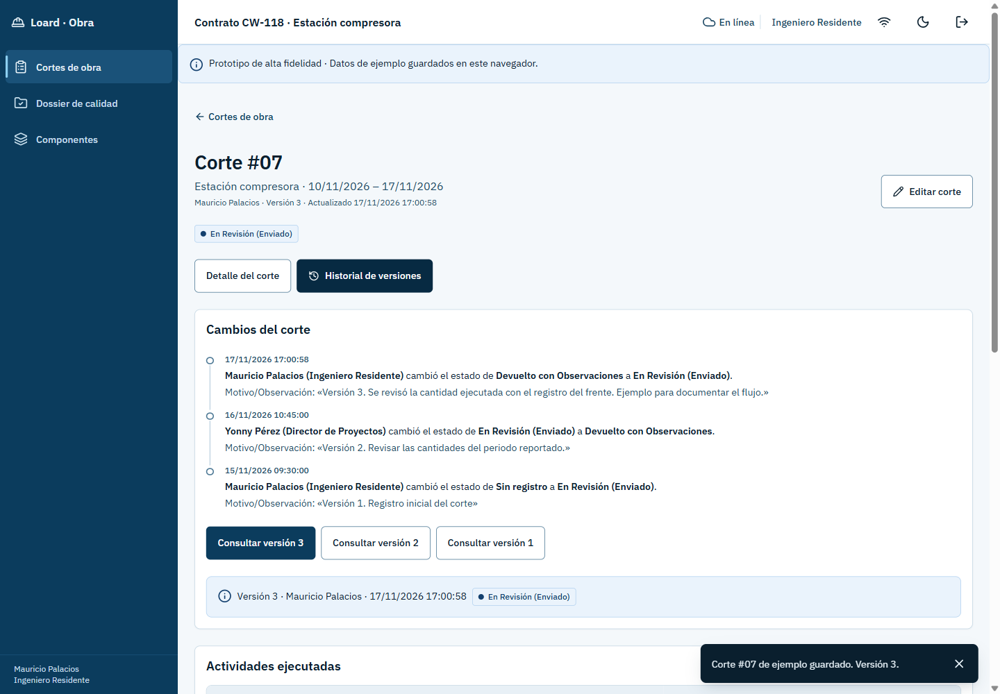

# Cómo trabajamos con la IA

Nuestra parte: HU1, HU2, HU7 y HU8.

## Qué decidió el integrante

El integrante aportó los archivos de guía y las referencias visuales. Pidió organizar bien las carpetas, reutilizar componentes y guardar qué se editó y cuándo. También aclaró que la entrega debía ser un prototipo y pidió dejar las credenciales de ejemplo completas al entrar.

Codex revisó esas indicaciones, propuso detalles, escribió el código y realizó las comprobaciones técnicas. El diseño común y los componentes del equipo se conservaron. No se presenta el código generado como si el integrante lo hubiera escrito a mano.

## Algunas instrucciones reales

> recuerda usar una buena estructura de carpetas re usar componentes etc..

> desactiva el backend por ahira y conviertelo en un prototipo de alta fidelidad de ejemplo

> no puedes poner esos datos de forma predeterminada cuando se entre a la app? osea la de correo y contraseña

## Cambios que sí hicimos

| Antes | Decisión y resultado | Dónde se puede comprobar |
| --- | --- | --- |
| El primer trabajo incluía un backend. | El integrante corrigió el alcance. Codex dejó el prototipo en la rama principal y apartó el backend. | Rama codex/backend-en-pausa; commit 110d3c3. |
| Se necesitaba editar un corte sin perder lo anterior. | Por solicitud del integrante, cada edición guarda otra versión, con autor, fecha y motivo. | Detalle del corte e historial. |
| Había que escribir las credenciales. | El integrante pidió que aparecieran completas. Se agregaron al elegir un perfil. | Commit 4025a93. |
| Faltaban nuestras pantallas NDT y de entrega. | El integrante pidió HU7 y HU8. Se conectaron con la checklist, la bitácora y el tablero del equipo. | Commit b7e2365. |

## Sobre las evidencias

Las capturas son actuales. No recrean imágenes antiguas ni muestran pruebas con personas. Los cambios anteriores se pueden revisar en Git. Codex también comprobó los flujos con el navegador y las pruebas automáticas.

El primer informe RITE era un ejemplo simulado. Después, el integrante aportó su propio Word y confirmó que corresponde a dos personas reales, con sesiones realizadas el 16 de noviembre de 2026. Ese archivo reemplaza el ejemplo anterior. Como no se tomaron capturas durante las sesiones, se añadieron imágenes de una revisión posterior del mismo día. En esa revisión se completaron los dos ajustes en el código del repositorio y se comprobaron en navegador; las figuras no se presentan como fotos de las pruebas con participantes.
