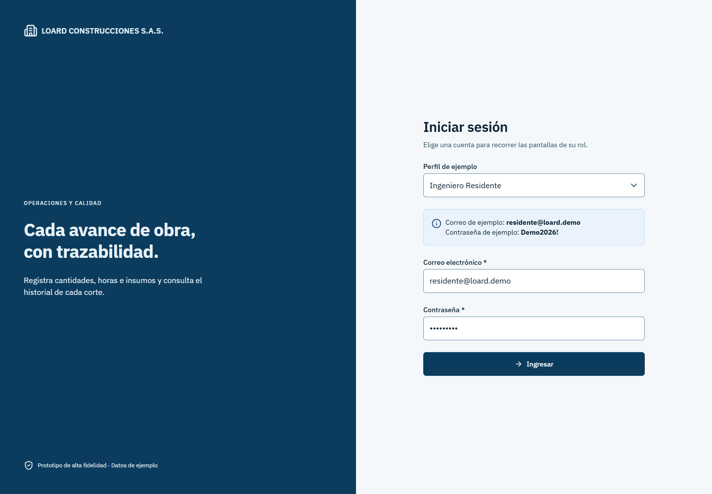
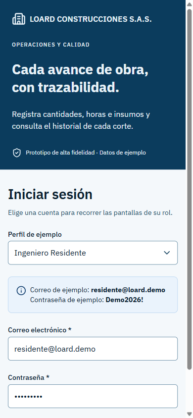
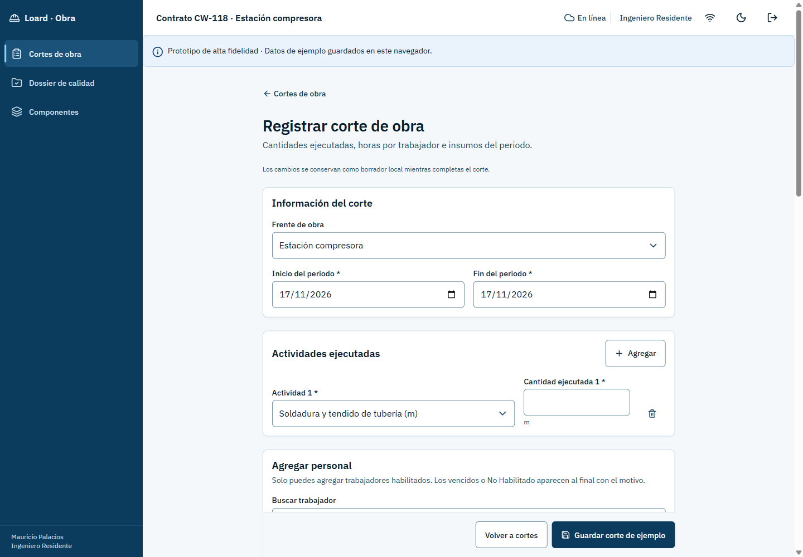
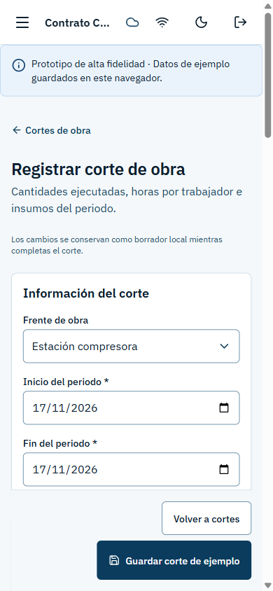
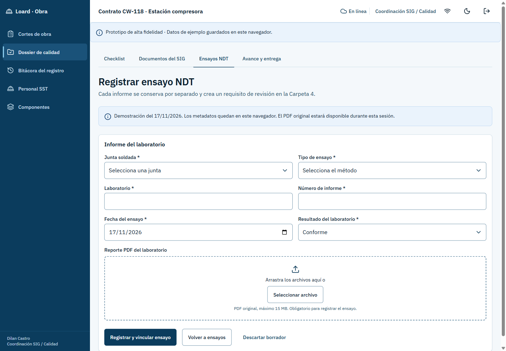
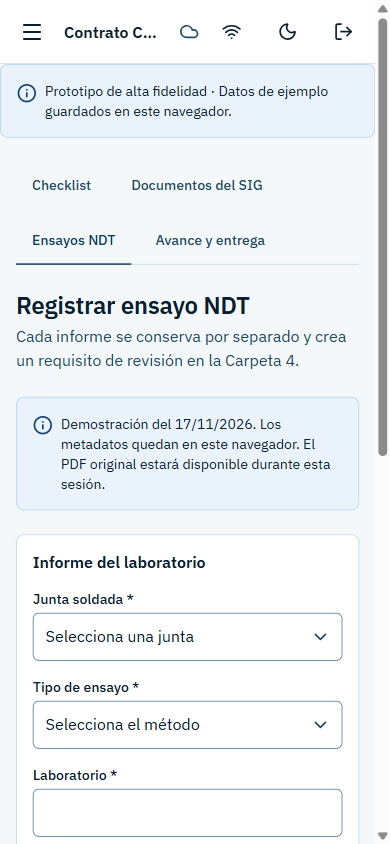
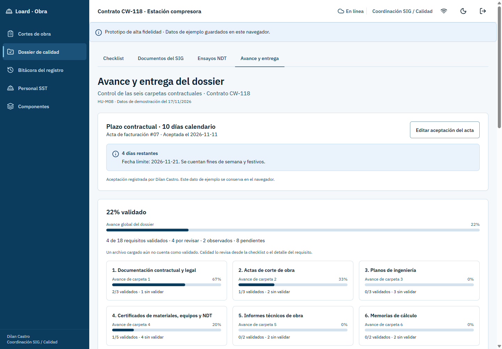
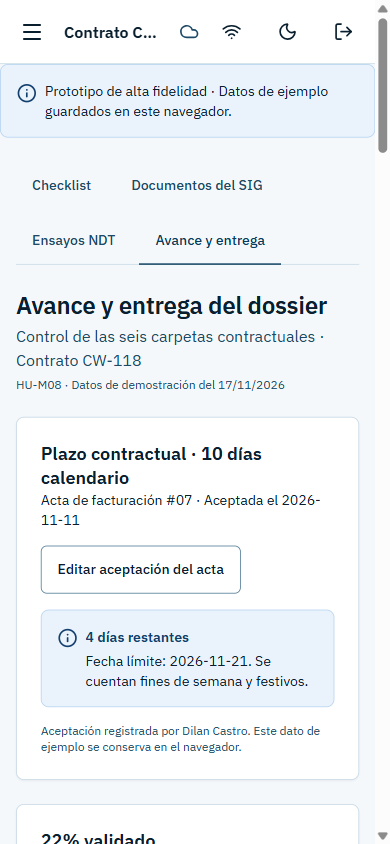

# Cómo se ve en computador y celular

Nuestra parte: HU1, HU2, HU7 y HU8. Se usaron los mismos colores, letra y componentes del equipo.

En computador algunos campos y tarjetas van lado a lado. En celular se acomodan uno debajo del otro. Los datos y las acciones son los mismos. Las siguientes capturas son reales de la versión actual; los datos de la aplicación son de ejemplo.

## HU1: entrar a la aplicación

El perfil, el correo y la contraseña quedan visibles en ambos tamaños.

## HU2: registrar un corte

Las fechas pasan de dos columnas a una. El formulario mantiene sus secciones. Para ver el resto se baja por la página.

## HU7: registrar un ensayo

En computador los campos van en dos columnas; en celular, en una. Se conserva la selección del PDF.

## HU8: revisar el dossier

Las seis carpetas se muestran en tres columnas o en una, según el espacio disponible.

Se revisaron tamaños de 1440 y 390 píxeles de ancho en un navegador. Esto no reemplaza una prueba en teléfonos físicos. El detalle de las capturas está en capturas/manifest.json.
