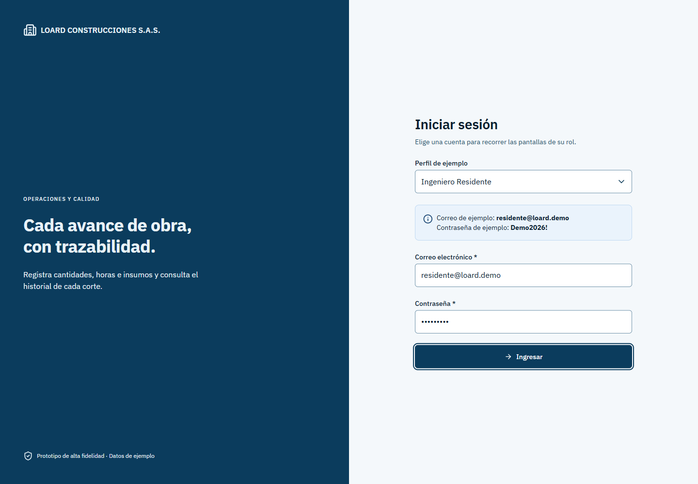
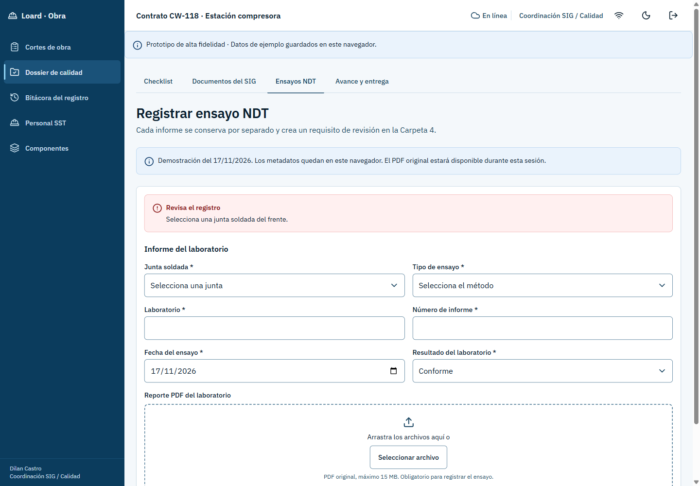

# Revisión de accesibilidad

Nuestra parte: HU1, HU2, HU7 y HU8.

Revisamos si las pantallas se pueden entender y usar con teclado, si el texto se distingue del fondo y si la información se acomoda en celular. Las comprobaciones fueron técnicas, sin participantes.

| Qué revisamos | Qué encontramos |
| --- | --- |
| Etiquetas | Los campos muestran qué dato se debe escribir. |
| Estados | Se escriben con texto; no dependen solo del color. |
| Errores | Se indica qué falta. En NDT el error es general; falta mejorar la ayuda junto a cada campo. |
| Teclado | Se probó entrar con Tab y Enter, y abrir/cerrar el diálogo del acta con teclado. |
| Texto y ancho | Se revisaron las capturas de computador/celular y una ampliación de texto de ejemplo. |

Queda pendiente probar con un lector de pantalla y recorrer todos los controles solo con teclado. Esta revisión no certifica que toda la aplicación cumpla WCAG, la guía de accesibilidad web. Tampoco reemplaza las pruebas con dos personas.

## Lo que comprobamos

Revisión del 16/11/2026 en navegador, sin participantes.

| Comprobación ejecutada | Resultado observado |
| --- | --- |
| Entrar con Tab y Enter | Correcto |
| Abrir el acta, mantener el foco dentro y cerrar con Escape | Correcto |
| Bloquear la descarga de cierre si faltan requisitos | Correcto |

Se guardaron 15 capturas y sus tamaños. No se detectó una página más ancha que la pantalla en esas capturas. También se amplió la letra del acceso al 200% como comprobación de ejemplo; no fue zoom nativo del navegador.

## Contraste del texto

Se compararon los colores definidos en el código. Un valor mayor indica más diferencia entre texto y fondo. La referencia para texto normal es 4,5:1.

| Uso | Tema claro | Tema oscuro |
| --- | --- | --- |
| Texto principal | 15.75:1 | 16.03:1 |
| Texto secundario | 9.42:1 | 9.54:1 |
| Botón principal | 11.55:1 | 10.66:1 |
| Mensaje de error | 8.39:1 | 8.89:1 |
| Advertencia | 8.04:1 | 10.35:1 |
| Mensaje de éxito | 8.52:1 | 10.00:1 |

Los pares revisados superan 4,5:1. Son colores del código, no una medición de toda la pantalla. El detalle está en capturas/contraste.json. El registro completo está en capturas/verificacion.json.

Fuente: [W3C: contraste mínimo del texto](https://www.w3.org/WAI/WCAG22/Understanding/contrast-minimum.html).
