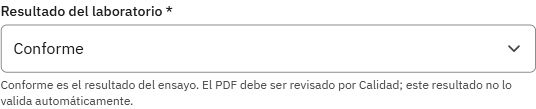

# Prueba RITE del prototipo Loard

## Alcance y criterios de evaluación

El análisis RITE aborda las historias de usuario HU1, HU2, HU7 y HU8 mediante dos recorridos de tareas (S1 y S2). Se examinan el acceso, la edición del corte, el registro NDT y la revisión del dossier, con énfasis en las dificultades de interacción y las oportunidades de mejora.

Las sesiones S1 y S2 se realizaron el 16 de noviembre de 2026.

## Datos de entrada y condiciones iniciales

Se definieron entradas y resultados para cada tarea. Ambos recorridos parten del mismo estado inicial, de modo que los registros de S1 no se acumulan en S2. La fecha de referencia configurada en el prototipo es el 17 de noviembre de 2026.

**Tabla 1**

*Datos de entrada de los recorridos*

| Registro | Datos de entrada |
| --- | --- |
| Acceso | Residente: residente@loard.demo. Calidad: calidad@loard.demo. Clave de acceso utilizada: Demo2026! |
| Corte #09 | Frente: Estación compresora. Periodo: 10 al 17 de noviembre de 2026. Soldadura y tendido de tubería: 120 m. |
| Personal e insumos | Fredy Cuero: 40 horas. Electrodo E7018: 12,5 kg. |
| Corrección del corte | De 120 m a 128 m. Motivo: «Incluí los 8 m del cierre del frente». Resultado: versión 2, con conservación de la versión 1. |
| Ensayo NDT | Junta JW-16-042. Laboratorio Delta. Informe RT-DEMO-001. Radiografía del 16 de noviembre de 2026. Resultado: Conforme. Archivo: RT-DEMO-001.pdf. |
| Dossier | Acta #07 aceptada el 11 de noviembre. Fecha límite: 21 de noviembre. Cuatro días restantes según el reloj del prototipo. |

Nota. Los recorridos se realizaron sobre el prototipo Loard utilizando las condiciones y datos de entrada indicados en la tabla.

## Recorrido S1: identificación de dificultades

En el recorrido S1 participó un usuario de experiencia media utilizando un computador. Completó el acceso sin asistencia. Durante la corrección del corte, registró 128 m y necesitó orientación para localizar en el historial la versión anterior de 120 m.

En el registro NDT se identificó una confusión entre el resultado «Conforme» del ensayo y la validación documental. El participante señaló: «Pensé que ya estaba aprobado porque decía Conforme». Se aclaró que el resultado emitido por el laboratorio no sustituye la revisión del PDF por el área de Calidad.

En el dossier se registraron inicialmente cuatro de dieciocho requisitos validados (22%). La carga del reporte no modificó el indicador. Después de validar el soporte, el estado pasó a cinco de dieciocho (28%). El borrador ZIP quedó disponible y el cierre permaneció bloqueado por los requisitos pendientes.

## Ajustes de interfaz entre recorridos

A partir de las dificultades identificadas en S1, se incorporaron dos ajustes de interfaz para el segundo recorrido: un acceso visible al historial y una aclaración del estado de revisión documental. La tabla 2 resume los comportamientos observados antes y después de los ajustes.

**Tabla 2**

*Comparación de comportamiento antes y después de los ajustes*

| Dificultad identificada | Comportamiento en S1 | Ajuste aplicado para S2 |
| --- | --- | --- |
| No encontrar el historial | S1 buscó la versión anterior entre los datos del corte. | Acceso «Ver historial» junto al mensaje de guardado; S2 lo localizó sin asistencia. |
| Confundir Conforme con Validado | S1 creyó que el resultado del laboratorio cerraba la revisión del PDF. | Texto aclaratorio: «El PDF debe ser revisado por Calidad»; S2 distinguió ambos estados. |

## Recorrido S2: revisión de los ajustes

En el recorrido S2 participó un usuario de menor experiencia utilizando un celular. Completó las mismas cuatro tareas con la interfaz ajustada. Localizó el historial y distinguió el resultado del ensayo del estado del documento. Persistió la necesidad de aclarar que las horas se registran por trabajador.

**Tabla 3**

*Resultados por tarea y duración registrada*

| Perfil | Tarea | Asistencia requerida | Tiempo registrado |
| --- | --- | --- | --- |
| S1 | Entrar | Sin ayuda | 35 s |
| S1 | Registrar y editar un corte | Con ayuda para encontrar el historial | 4 min 10 s |
| S1 | Registrar un NDT | Con ayuda sobre la validación | 3 min 20 s |
| S1 | Revisar el dossier y descargar | Sin ayuda | 2 min 05 s |
| S2 | Entrar | Sin ayuda | 45 s |
| S2 | Registrar y editar un corte | Con ayuda sobre las horas | 3 min 30 s |
| S2 | Registrar un NDT | Sin ayuda | 2 min 30 s |
| S2 | Revisar el dossier y descargar | Sin ayuda | 2 min 15 s |

Nota. Los tiempos y niveles de asistencia corresponden a los resultados registrados y verificados en los dos recorridos.

## Análisis comparativo y conclusiones

El tiempo total registrado para S1 fue de 10 minutos y 10 segundos; para S2, de 9 minutos. Ambos participantes completaron las cuatro tareas. S1 necesitó ayuda en dos de ellas y S2 en una. Los resultados muestran una reducción de 1 minuto y 10 segundos en el segundo recorrido, junto con una menor necesidad de asistencia. Dado que se trata de dos participantes con diferentes perfiles y dispositivos, esta comparación describe los resultados observados sin atribuir toda la diferencia exclusivamente a los cambios de interfaz.

La prueba RITE permitió identificar dificultades concretas en la consulta del historial y en la interpretación del estado documental, aplicar ajustes entre recorridos y comprobar el comportamiento de las tareas evaluadas. Como oportunidad de mejora pendiente, se identificó la necesidad de explicar con mayor claridad el registro de horas por trabajador.

## Revisión actual de los ajustes

Las capturas se tomaron el 16 de noviembre de 2026 durante una revisión técnica posterior. No se tomaron durante S1 y S2. Los dos ajustes se incorporaron al código del repositorio en esta revisión.

**Figura 1**

*Acceso al historial desde el aviso de guardado*

**Figura 2**

*Ayuda sobre el resultado del ensayo y la revisión del PDF*

Nota. Se usaron datos de demostración. Se muestran las capturas en blanco y negro; los originales se guardaron junto con la fecha y el registro de comprobación.
