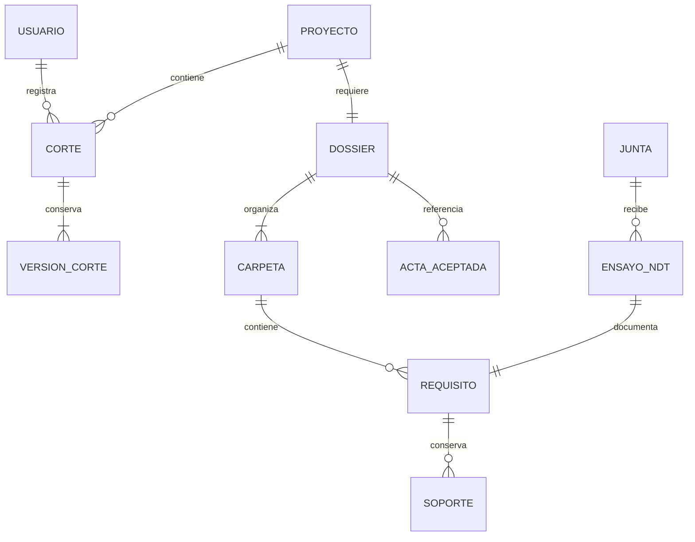

# Datos y conexiones que necesitaríamos

Propuesta para HU1, HU2, HU7 y HU8. Es una idea para el futuro: NO hay un backend activo en el prototipo.

Una entidad es un grupo de datos, parecido a una tabla. Una API permite que una pantalla pida o guarde datos en un servidor. Hoy los ejemplos se guardan en el navegador.

## Cómo se relacionan los datos

En el dibujo, 1:N significa que un registro puede tener varios relacionados. Por ejemplo, un corte puede tener varias versiones. 1:1 significa uno a uno.

## Qué guardaríamos

| Grupo de datos | Información principal |
| --- | --- |
| Usuario y rol | Nombre, correo único, perfil y cuenta activa. La contraseña protegida se guardaría solo en el servidor. |
| Proyecto y frente | Código, nombre y frente al que pertenece el trabajo. Reutilizar los datos del equipo. |
| Corte | Número, proyecto, frente, autor, estado y versión actual. |
| Versión del corte | Periodo, observaciones, motivo del cambio, autor y fecha. No borrar las versiones anteriores. |
| Detalles del corte | Actividades con cantidad/unidad; trabajadores con horas; insumos con cantidad/unidad. Cada grupo se guarda por versión. |
| Junta y ensayo NDT | Código de junta, laboratorio, número de informe, método, fecha, resultado, PDF y quién lo registró. |
| Dossier, carpeta y requisito | Proyecto, seis carpetas, nombre del requisito, estado y observación. Reutilizar la checklist de HU5/HU6. |
| Soporte PDF | Nombre, tamaño, ubicación del archivo, versión, autor y fecha. Conservar los archivos anteriores. |
| Acta aceptada | Referencia, fecha de aceptación, responsable y fecha de registro. |
| Historial de cambios | Qué cambió, valor anterior, valor nuevo, motivo, persona y fecha. Usar el historial común del equipo. |

Cada informe NDT debe tener su propio requisito, aunque sea de la misma junta. No debe reemplazar el reporte de otra junta. Los catálogos de actividades, trabajadores e insumos se comparten con los otros módulos.

## API propuesta: qué pediría cada pantalla

GET consulta datos y POST envía datos. Las rutas siguientes son propuestas; todavía no existen como servicios del prototipo.

| Ruta propuesta | Para qué serviría |
| --- | --- |
| POST /api/sesiones | Entrar y conocer el perfil del usuario. |
| GET o DELETE /api/sesiones/actual | Consultar o cerrar la sesión. |
| GET o POST /api/proyectos/:id/cortes | Ver la lista o guardar un corte nuevo. |
| GET /api/cortes/:id | Abrir el detalle de un corte. |
| GET o POST /api/cortes/:id/versiones | Ver el historial o guardar una corrección con su motivo. |
| GET /api/proyectos/:id/juntas | Cargar las juntas disponibles para registrar el ensayo. |
| GET o POST /api/proyectos/:id/ensayos | Buscar o registrar ensayos del laboratorio. |
| POST /api/requisitos/:id/soportes y /revisiones | Adjuntar el PDF y revisarlo; acordar estas rutas con HU6. |
| GET /api/proyectos/:id/dossier/avance | Ver porcentaje, faltantes y fecha límite. |
| POST /api/dossiers/:id/actas-aceptadas | Registrar la aceptación del acta y guardar sus cambios. |
| POST /api/dossiers/:id/exportaciones | Preparar el ZIP parcial o el cierre y devolver un enlace de descarga. |

## Reglas que deben conservarse

- Revisar en el servidor quién tiene permiso para cada acción.
- Evitar registros repetidos al reintentar. No repetir un informe del mismo laboratorio en el proyecto.
- Guardar el ensayo y su requisito juntos. Si falla una parte, no dejar el registro incompleto.
- Antes de corregir un corte, comprobar que nadie guardó otra versión mientras tanto.
- Contar diez días calendario desde la aceptación del acta. Un archivo cargado todavía no cuenta como validado.
- Permitir el cierre solo cuando las seis carpetas tengan requisitos con soporte validado.

El equipo aún debe acordar cómo guardar los PDF de forma permanente, cómo administrar las cuentas y cómo conectar el acta con facturación. Esta propuesta no activa ni modifica el backend apartado.
