# Módulo II · Componentes, diseño responsivo y heurísticas · HU-M03 y HU-M04

Loard Construcciones S.A.S. · Hito 2 · Aporte de Sebastián Gutiérrez.

## Inventario de componentes

Las dos historias se armaron sobre la biblioteca común del equipo (`src/components`). No se crearon botones, campos ni colores nuevos.

### Componentes compartidos que se reutilizaron

| Componente | Para qué se usa en HU-M03 y HU-M04 | Estados o variantes |
| --- | --- | --- |
| `FileUpload` | Zona para elegir o arrastrar fotos y PDF. | Normal, arrastrando encima, con archivos rechazados. |
| `UploadItem` | Tarjeta de cada archivo en carga. | Subiendo con %, confirmando, en espera de señal, error con «Reintentar». |
| `Drawer` | Visor de la foto o el PDF. | Panel lateral desde 1024 px; pantalla completa en celular. |
| `Dialog` | Confirmar el visado y escribir la devolución. | Foco inicial configurable; pregunta antes de descartar texto escrito. |
| `Button` | Ver, Quitar, Revisar, Visar, Devolver, Confirmar. | Principal, secundario, ámbar, fantasma; cargando; bloqueado con motivo visible. |
| `Chip` | Causas frecuentes de devolución. | Seleccionado / sin seleccionar (`aria-pressed`). |
| `TextArea` | Observación para el residente. | Contador del mínimo de 10 caracteres. |
| `Banner` | Aviso de devolución, corte visado, sin soportes, versión cambiada. | Info, advertencia, error, éxito. |
| `StatusBadge` | Estado del corte. | En Revisión, Visado, Devuelto con Observaciones. |
| `KpiCard` | «Pendientes de visado» en la bandeja. | Con acción de filtro y estado seleccionado. |
| `ResponsiveTable` | Bandeja de cortes. | Tabla en escritorio; tarjetas en celular. |
| `ToastProvider` | «Deshacer» al quitar un soporte y confirmación de decisiones. | Informativo y con «Deshacer» de 5 s (también `Ctrl+Z`). |
| `Timeline` | Historial de versiones con cada decisión. | Autor, rol, estado anterior y nuevo, observación. |

### Componentes propios de las historias

Siguiendo la regla del módulo, lo que solo usan los cortes queda en `features/cortes`. Si otro módulo lo necesita, se mueve a `components`.

| Componente | Archivo | Responsabilidad |
| --- | --- | --- |
| `SoportesCorte` | `features/cortes/SoportesCorte.tsx` | Lista, carga simulada con progreso, cola sin señal, duplicados, «Deshacer» y permisos por rol. |
| `VisorSoporte` | `features/cortes/SoportesCorte.tsx` | Envuelve `Drawer`: imagen o PDF, metadatos y «Descargar». |
| `RevisionCorte` | `features/cortes/RevisionCorte.tsx` | Explicación y avisos del Director, barra fija de decisión y confirmación del visado. |
| `AvisoDevolucion` | `features/cortes/RevisionCorte.tsx` | Observación del Director para el residente con «Corregir corte». |
| `DialogoObservacion` | `features/cortes/DialogoObservacion.tsx` | Observación obligatoria con causas frecuentes. Pensado para reutilizarse en «Observar requisito» del dossier. |

### Estructura en React

```text
DetalleCorte (página /cortes/:id)
├── PageHeader · StatusBadge · AvisoDevolucion
├── ValoresCorte (actividades, horas-hombre, insumos)
├── SoportesCorte
│   ├── ItemSoporte × n ──► VisorSoporte (Drawer)
│   └── FileUpload ──► UploadItem × n
└── RevisionCorte (solo Director, corte en revisión)
    ├── Dialog «¿Confirmar visado técnico…?»
    └── DialogoObservacion ──► TextArea + Chip × 5
```

Las reglas viven fuera de los componentes: `soportes.ts` (validación, permisos, retiro sin borrado) y `modeloDemo.ts` (`revisarCorteDemo`: quién puede decidir, sobre qué versión y con qué observación). `CortesDemoContext` los comparte con las pantallas.

## Diseño responsivo

Se revisaron dos tamaños: computador de 1440 × 900 px y celular de 390 × 844 px. Los datos y las acciones son los mismos; cambia la disposición.

| Elemento | Computador | Celular |
| --- | --- | --- |
| Menú | Lateral fijo. | Botón de menú en la barra superior. |
| Bandeja de cortes | Tabla con columnas. | Una tarjeta por corte. |
| Soportes | Botones «Ver» y «Quitar» a la derecha de cada archivo. | Botones debajo del nombre del archivo. |
| Visor | Panel derecho; el corte sigue visible a la izquierda. | Pantalla completa con «Cerrar visor». |
| Barra del Director | Fila a la derecha con los textos completos. | Dos botones del mismo ancho: «Devolver» y «Visar corte». |
| Diálogo de devolución | Ventana centrada. | Ocupa el ancho; los chips se apilan y el contenido se desplaza. |

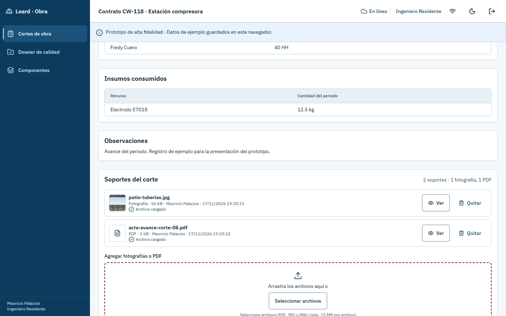

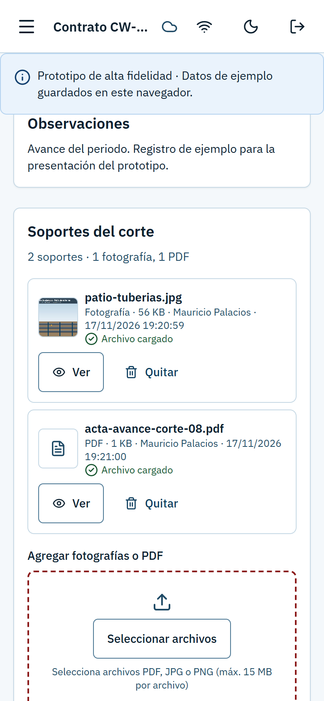 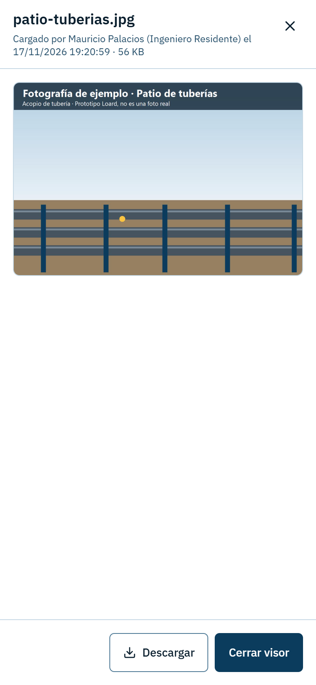

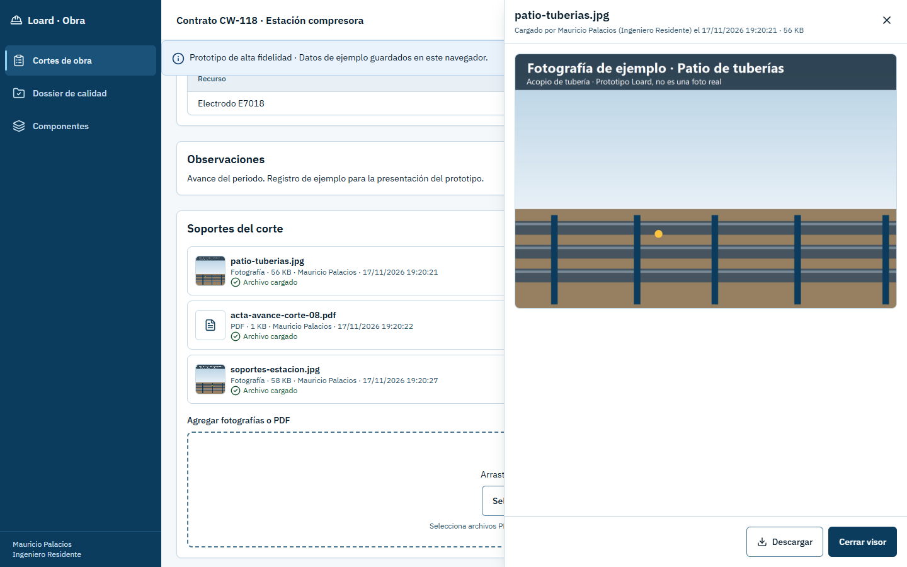

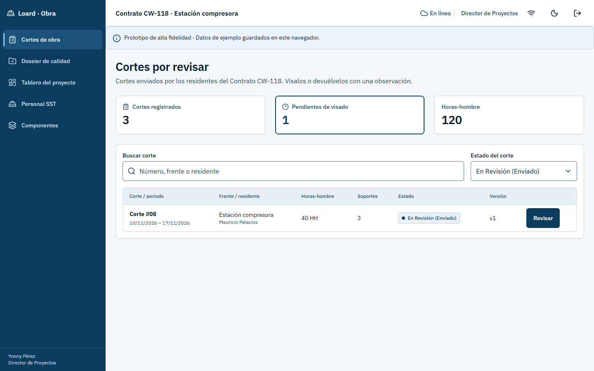

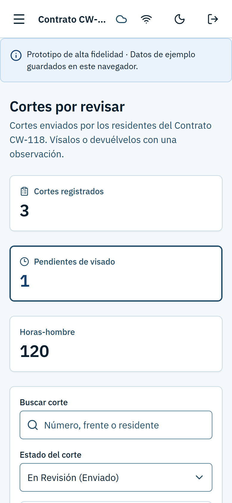 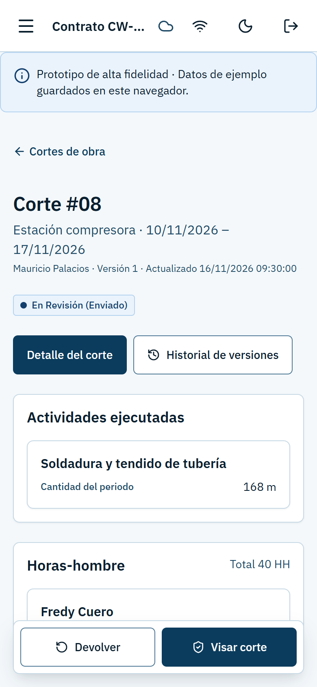

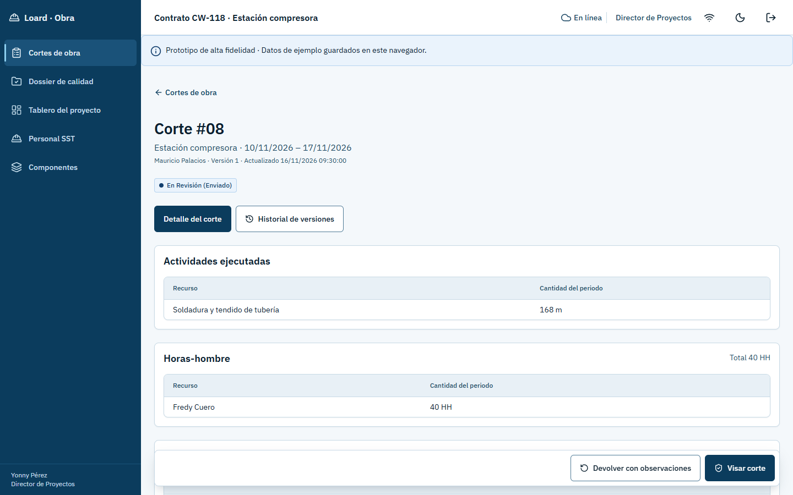

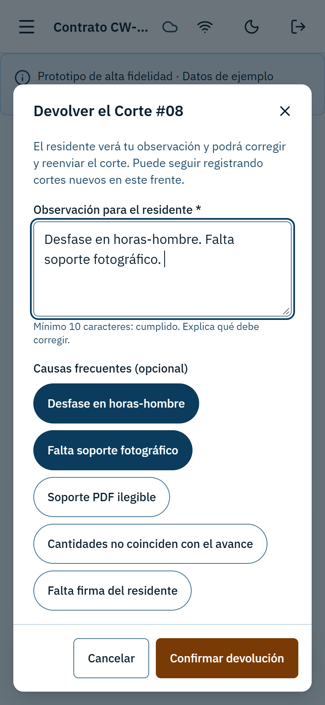 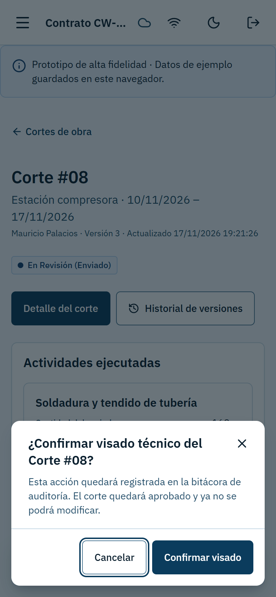

## Heurísticas de Nielsen

La guía pide al menos cinco. Las diez se pueden comprobar en estas pantallas.

| # | Heurística | HU-M03 · Soportes | HU-M04 · Visado |
| --- | --- | --- | --- |
| 1 | Visibilidad del estado del sistema | Porcentaje de carga, «Confirmando carga…», «Archivo cargado» y resumen «2 soportes · 1 fotografía, 1 PDF». | Insignia de estado, indicador de pendientes, botón «Registrando visado…» y aviso al terminar. |
| 2 | Relación con el mundo real | «Soportes», «Corte #08», «fotografías del frente». | «Visar», «Devolver con observaciones», causas como «Desfase en horas-hombre». |
| 3 | Control y libertad | Cancelar una carga, «Deshacer» al quitar, cerrar el visor con Esc. | Foco inicial en «Cancelar»; pregunta antes de descartar una observación escrita. |
| 4 | Consistencia y estándares | Mismos `FileUpload`, `UploadItem` y mensajes que SST. | Estados oficiales de `lib/estados` y el mismo `Dialog` de todo el prototipo. |
| 5 | Prevención de errores | Tipo y peso validados antes de subir; sin duplicados; sin cambios en cortes visados. | Confirmación del visado; devolución bloqueada sin 10 caracteres; control de versión. |
| 6 | Reconocer antes que recordar | Miniaturas e íconos por tipo de archivo. | Datos y soportes en una sola vista; la observación queda visible al corregir. |
| 7 | Flexibilidad y eficiencia | Arrastrar y soltar además del botón; selección múltiple. | Bandeja ya filtrada; chips que escriben la causa; `Ctrl+Z` para deshacer. |
| 8 | Diseño estético y minimalista | Cada rol ve solo sus acciones; el color se reserva para estados. | Dos acciones claras; en celular la barra mide 66 px. |
| 9 | Reconocer y recuperarse de errores | Mensajes con archivo, causa y solución; «Reintentar» y cola sin señal. | Mensajes de conexión y de versión con la acción que los resuelve. |
| 10 | Ayuda y documentación | Formatos y límite visibles antes de subir. | El diálogo explica que la decisión queda en la bitácora y que no frena el frente. |

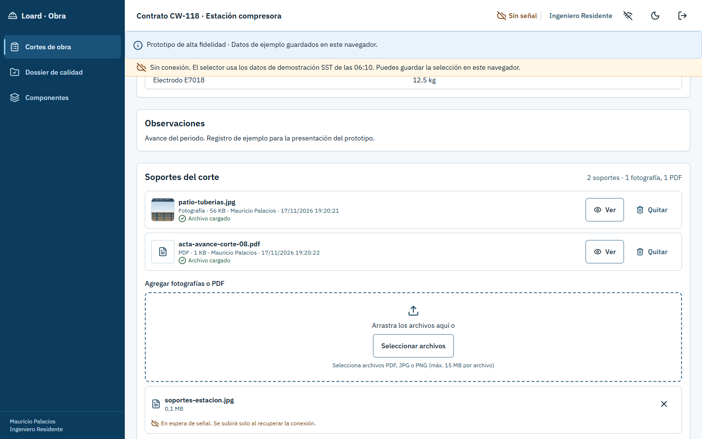

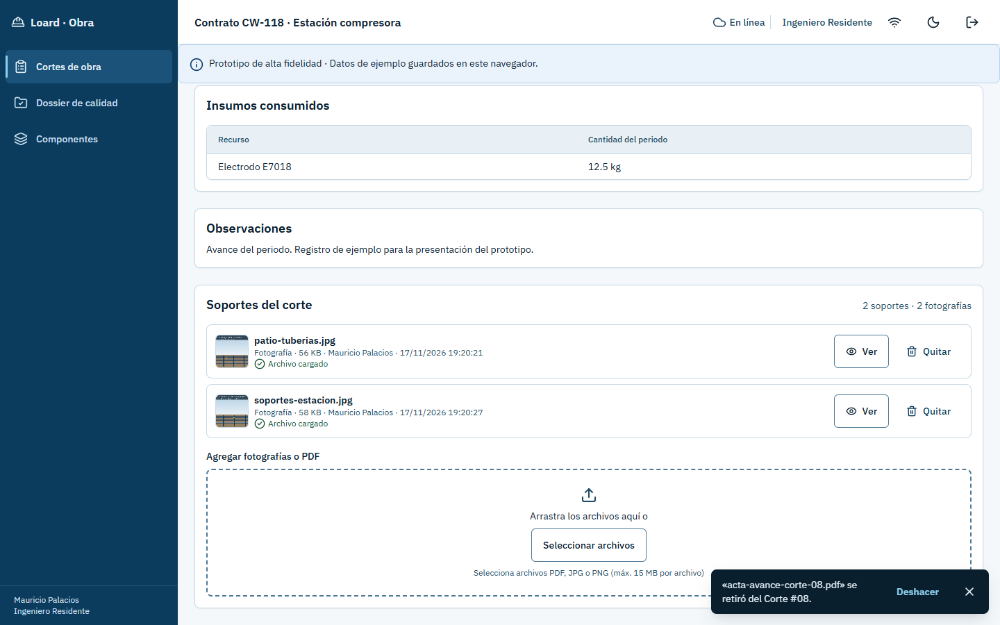

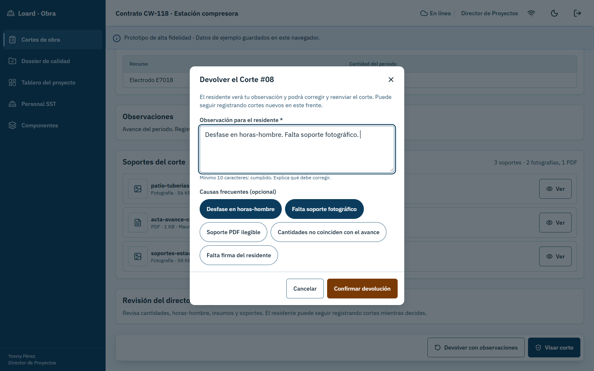

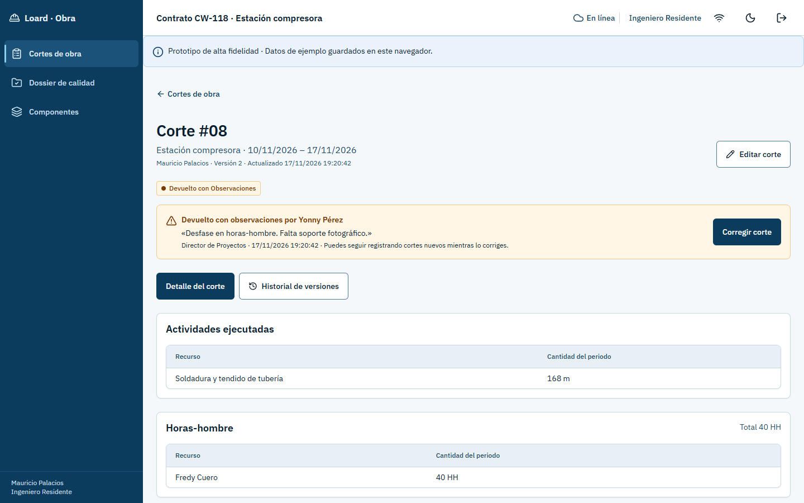

Esta tabla es una revisión del diseño. No reemplaza las pruebas con usuarios del Módulo III.
