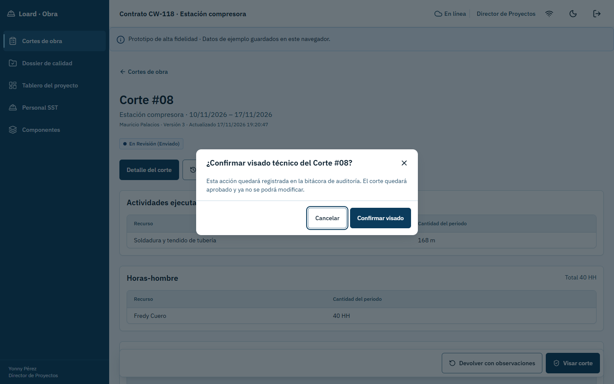
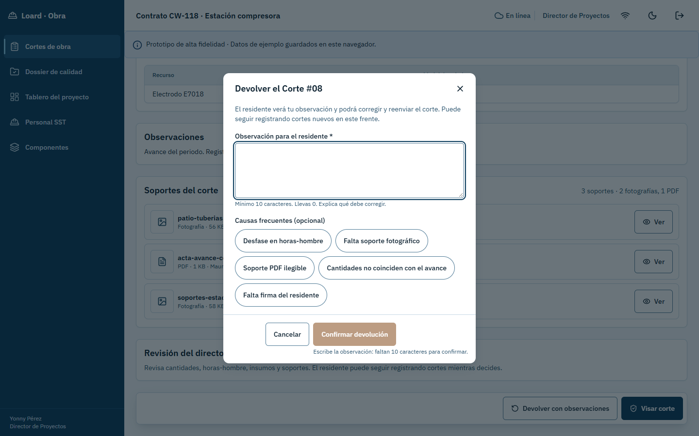
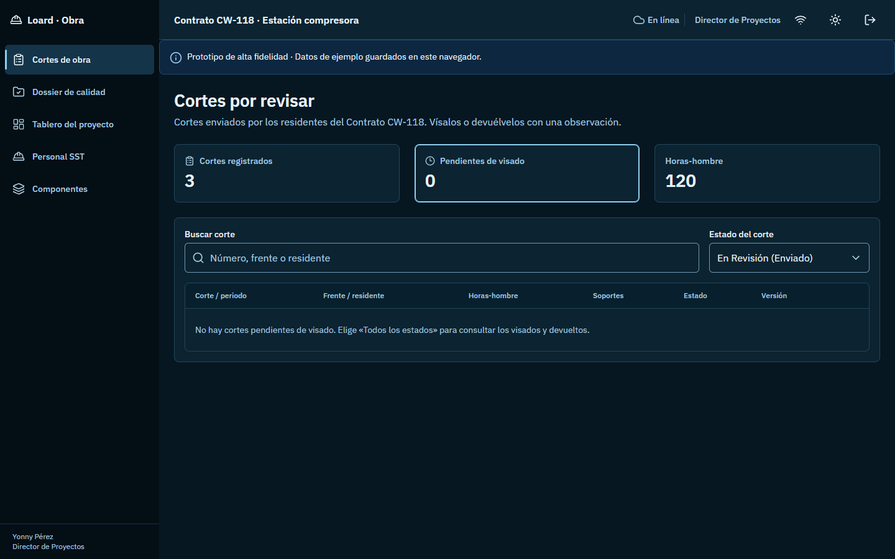

# Módulo III · Usabilidad y accesibilidad · HU-M03 y HU-M04

Loard Construcciones S.A.S. · Hito 2 · Aporte de Sebastián Gutiérrez.

## Auditoría de accesibilidad (WCAG 2.2)

Revisé contraste, tamaño de los controles, navegación por teclado, mensajes para lectores de pantalla y reflujo en pantallas angostas. Las comprobaciones se automatizaron sobre el prototipo en Microsoft Edge, con datos de ejemplo y sin participantes. Los resultados quedan guardados en `contraste.json` y `verificacion.json`, y se repiten con los scripts de `Modulo-I-Prototipo/HU03-HU04/herramientas`.

### Contraste de color

Valores calculados a partir de `styles/tokens.css`. El texto normal exige 4,5:1 (criterio 1.4.3). Los bordes y el anillo de foco exigen 3:1 (criterio 1.4.11).

| Uso en pantalla | Tema claro | Tema oscuro | Mínimo |
| --- | --- | --- | --- |
| Texto principal de las tarjetas | 16,82:1 | 14,22:1 | 4,5:1 |
| Texto secundario (tamaño, autor, fecha del soporte) | 9,42:1 | 9,54:1 | 4,5:1 |
| Botón principal «Visar corte» y «Revisar» | 11,55:1 | 10,66:1 | 4,5:1 |
| Botón ámbar «Confirmar devolución» | 8,62:1 | 11,80:1 | 4,5:1 |
| Insignia «En Revisión (Enviado)» | 9,54:1 | 8,75:1 | 4,5:1 |
| Insignia «Visado» y «Archivo cargado» | 8,52:1 | 10,00:1 | 4,5:1 |
| Insignia y aviso «Devuelto con Observaciones» | 8,04:1 | 10,35:1 | 4,5:1 |
| Mensaje de archivo rechazado | 9,29:1 | 8,51:1 | 4,5:1 |
| Texto del aviso «Deshacer» | 14,81:1 | 14,81:1 | 4,5:1 |
| Botón «Deshacer» dentro del aviso | 9,85:1 | 10,17:1 | 4,5:1 |
| Anillo de foco del teclado | 11,55:1 | 9,46:1 | 3:1 |
| Borde de botones secundarios y campos | 4,61:1 | 5,36:1 | 3:1 |

Los doce pares cumplen en ambos temas. Además, ningún estado depende solo del color: cada insignia y cada aviso llevan texto.

### Teclado, foco, mensajes y tamaños

| Criterio WCAG | Comprobación | Resultado observado |
| --- | --- | --- |
| 4.1.3 Mensajes de estado | El rechazo de un archivo se anuncia como alerta. | Cumple: «“informe.docx” no es PDF, JPG ni PNG…» |
| 4.1.3 Mensajes de estado | El progreso de carga se expone como barra con valor. | Cumple: «Carga de patio-tuberias.jpg», 37 %. |
| 2.5.8 Tamaño del objetivo | Ver, Quitar y Seleccionar archivos miden al menos 44 × 44 px. | Cumple: 48 px de alto (79, 98 y 166 px de ancho). |
| 2.4.3 Orden del foco | Al abrir el visor con Enter, el foco entra al panel. | Cumple: el foco queda en «Cerrar». |
| 2.1.2 Sin trampas de teclado | Esc cierra el visor y el foco vuelve a «Ver». | Cumple. |
| 2.1.1 Teclado | Quitar con Enter y deshacer con `Ctrl+Z` dentro de 5 s. | Cumple: el soporte se oculta y vuelve. |
| 3.3.1 Identificación de errores | En un corte visado, «Editar corte» explica el bloqueo. | Cumple: motivo enlazado con `aria-describedby`. |
| 2.4.3 Orden del foco | Al abrir «Devolver», el foco queda en la observación. | Cumple. |
| 3.3.2 Etiquetas o instrucciones | «Confirmar devolución» bloqueado dice cuántos caracteres faltan. | Cumple: «faltan 10 caracteres para confirmar». |
| 3.3.4 Prevención de errores | Con 10 caracteres el botón se habilita. | Cumple. |
| 3.3.4 Prevención de errores | Esc con texto escrito pregunta antes de descartar. | Cumple: «¿Descartar la observación escrita?». |
| 3.3.4 Prevención de errores | El visado abre con el foco en «Cancelar». | Cumple. |
| 2.1.2 Sin trampas de teclado | Con Tab el foco recorre el diálogo sin salir de él. | Cumple. |
| 2.4.3 Orden del foco | Tras visar, el foco pasa al nuevo estado del corte. | Cumple: el foco queda en «Visado». |
| 1.3.1 Información y relaciones | Un corte ya devuelto no muestra acciones de visado. | Cumple. |
| 3.3.2 Etiquetas o instrucciones | Sin señal, Visar y Devolver se bloquean con el motivo enlazado. | Cumple: «Necesitas conexión para visar o devolver cortes…». |
| 1.4.10 Reflujo | Sin desplazamiento horizontal a 320 px en el detalle con soportes, la revisión y la bandeja. | Cumple: la página mide 320 px en los tres casos. |

**Límites de esta auditoría.** No se probó con un lector de pantalla real (NVDA o VoiceOver) ni en teléfonos físicos. Los controles se midieron en Edge con tamaños emulados. Esta revisión no certifica que toda la aplicación cumpla WCAG.

## Revisión técnica previa a las pruebas con usuarios

Antes de subir las historias, recorrí ambos flujos en el navegador, en computador y en celular. Estos problemas se detectaron y corrigieron. Son hallazgos de revisión técnica, no de usuarios.

| Problema detectado | Cambio aplicado en el prototipo |
| --- | --- |
| En celular, la barra de revisión ocupaba unos 330 px y tapaba los datos que el Director debe revisar. | Solo la fila de botones queda fija (66 px). La explicación y los avisos pasan al contenido. |
| Al visar o devolver, el foco del teclado quedaba en la página vacía. | El foco pasa al nuevo estado del corte. |
| «Cancelar» se estiraba en alto junto al botón bloqueado del diálogo. | El botón se alinea al inicio de la fila. |
| A 1440 px, «Devolver con observaciones» se partía en dos líneas. | El botón conserva su ancho natural desde tableta. |
| Un corte visado se podía editar, en contra de las historias. | El modelo rechaza el cambio y la pantalla explica el motivo. |

## Validación RITE con usuarios

**Estado: pendiente.** La guía exige al menos dos usuarios reales. Este documento deja listo el protocolo; los resultados se completan después de cada sesión. No se presentan resultados inventados.

### Perfiles

| Participante | Perfil buscado | Dispositivo |
| --- | --- | --- |
| P1 | Persona que haya reportado avances de obra o tareas con evidencia (residente, estudiante de ingeniería civil o similar). | Computador |
| P2 | Persona que revise o apruebe trabajo de otros (director, coordinador, docente). | Celular |

### Tareas

| # | Rol | Tarea que se lee al participante | Se considera lograda si… |
| --- | --- | --- | --- |
| T1 | Residente | «Agrega dos fotos y un PDF al Corte #08.» | Los tres archivos quedan en «Soportes del corte». |
| T2 | Residente | «Intenta adjuntar este documento de Word.» | Entiende por qué se rechaza sin ayuda. |
| T3 | Residente | «Quitaste una foto por error. Recupérala.» | Usa «Deshacer» antes de 5 s. |
| T4 | Director | «Encuentra los cortes que te faltan por revisar y abre el #08.» | Llega al detalle desde la bandeja. |
| T5 | Director | «Revisa el PDF y devuelve el corte explicando qué falta.» | Confirma una devolución con observación. |
| T6 | Residente | «Mira qué te pidió el Director, corrige y reenvía.» | El corte vuelve a «En Revisión (Enviado)». |
| T7 | Director | «Visa la versión corregida.» | El corte queda «Visado». |

### Qué registrar en cada sesión

Para cada tarea: si se completó sin ayuda, con ayuda o no se completó; el tiempo; los errores; y una frase textual del participante. Según la metodología RITE, si un problema se repite o bloquea la tarea, se corrige el prototipo antes de la siguiente sesión y se anota el cambio.

### Resultados (por completar)

| Participante | Tarea | Resultado | Tiempo | Comentario textual |
| --- | --- | --- | --- | --- |
| P1 | T1 a T7 | | | |
| P2 | T1 a T7 | | | |

| Problema detectado con usuarios | Participante | Cambio aplicado en el prototipo | Commit |
| --- | --- | --- | --- |
| | | | |
