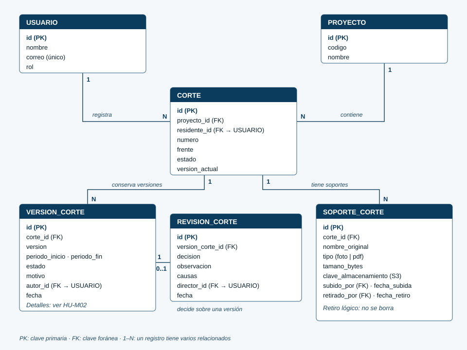

# Módulo IV · Esquema de datos y mapa de API · HU-M03 y HU-M04

Loard Construcciones S.A.S. · Hito 2 · Aporte de Sebastián Gutiérrez.

Propuesta para el backend en Django y PostgreSQL. Hoy el prototipo guarda los datos de ejemplo en el navegador; **no hay un servidor activo**. Siguiendo la guía, el esquema solo incluye las tablas y campos que necesitan las pantallas de estas dos historias.

## Diagrama entidad-relación mínimo

`USUARIO`, `PROYECTO`, `CORTE` y `VERSION_CORTE` son compartidas con HU-M01 y HU-M02. Se usan los mismos nombres que el compañero propuso para esas historias, para que el modelo quede como uno solo. Las tablas nuevas de estas historias son `SOPORTE_CORTE` y `REVISION_CORTE`.

## Qué dato alimenta cada pantalla

| Tabla | Campo | Dónde se ve |
| --- | --- | --- |
| `SOPORTE_CORTE` | `nombre_original`, `tipo`, `tamano_bytes` | Nombre, «Fotografía» o «PDF» y tamaño en la lista de soportes. |
| | `subido_por`, `fecha_subida` | Autor y fecha de cada soporte y metadatos del visor. |
| | `clave_almacenamiento` | Ubicación del archivo en el almacenamiento compatible con S3; con ella se genera el enlace para «Ver» y «Descargar». |
| | `retirado_por`, `fecha_retiro` | Retirar un soporte no lo borra: queda fuera de la lista pero se conserva para la bitácora (HU-M11). |
| `REVISION_CORTE` | `decision` | «Visado» o «Devuelto con Observaciones». |
| | `observacion`, `causas` | Texto del aviso que ve el residente y causas frecuentes elegidas. |
| | `director_id`, `fecha` | «Devuelto con observaciones por Yonny Pérez», fecha y hora del historial. |
| | `version_corte_id` | Versión exacta que se revisó; impide decidir sobre datos que ya cambiaron. |
| `CORTE` | `estado`, `version_actual` | Insignia de estado, bandeja «Pendientes de visado» y control de versión. |
| `VERSION_CORTE` | `estado`, `motivo`, `autor_id`, `fecha` | Línea de tiempo del «Historial de versiones». |

## Mapa de API

Rutas propuestas entre el frontend React y el backend. Ninguna existe todavía como servicio.

| Método y ruta | Pantalla que la usa | Respuesta esperada |
| --- | --- | --- |
| `GET /api/proyectos/:id/cortes?estado=En Revisión (Enviado)` | Bandeja del Director. | Lista con número, frente, periodo, horas, cantidad de soportes y estado. |
| `GET /api/cortes/:id` | Detalle del corte. | Datos de la versión actual y soportes vigentes. |
| `GET /api/cortes/:id/soportes` | Sección «Soportes del corte». | Soportes vigentes, sin los retirados. |
| `POST /api/cortes/:id/soportes/solicitudes-carga` | Al elegir un archivo. | URL firmada para subirlo directo al almacenamiento. Rechaza tipo o peso no permitidos (422). |
| `POST /api/cortes/:id/soportes` | Al terminar la carga («Confirmando carga…»). | 201 con el soporte asociado. Usa `Idempotency-Key` para no duplicar si se reintenta. |
| `GET /api/soportes/:id/archivo` | «Ver» y «Descargar». | Enlace temporal al archivo. |
| `DELETE /api/cortes/:id/soportes/:soporteId` | «Quitar», al terminar los 5 s de «Deshacer». | 204. Responde 409 si el corte está visado y 403 si no es el residente autor. |
| `POST /api/cortes/:id/revisiones` | «Confirmar visado» y «Confirmar devolución». | 201 con la nueva versión. Envía `decision`, `observacion`, `causas` y `version_esperada`. |
| `GET /api/cortes/:id/versiones` | «Historial de versiones» y bitácora (HU-M11). | Versiones con autor, rol, estado anterior y nuevo, y observación. |

## Reglas que debe hacer cumplir el servidor

- Solo el residente autor agrega o retira soportes, y solo mientras el corte no esté visado.
- Solo acepta PDF, JPG y PNG de hasta 15 MB, aunque el navegador ya lo haya validado.
- Solo el Director de Proyectos registra revisiones, y solo sobre cortes en revisión.
- Una devolución exige una observación de al menos 10 caracteres.
- Si `version_esperada` no coincide con la versión actual, responde 409 «El corte cambió» y no registra nada.
- La revisión y la nueva versión se guardan en una sola transacción, junto con el evento de bitácora.
- Visar o devolver no bloquea que el residente registre cortes nuevos en el mismo frente.

Falta acordar con el equipo dónde se guardarán los archivos de forma permanente y cómo se administrarán las cuentas. Esta propuesta no activa ni modifica el backend apartado en la rama `codex/backend-en-pausa`.
